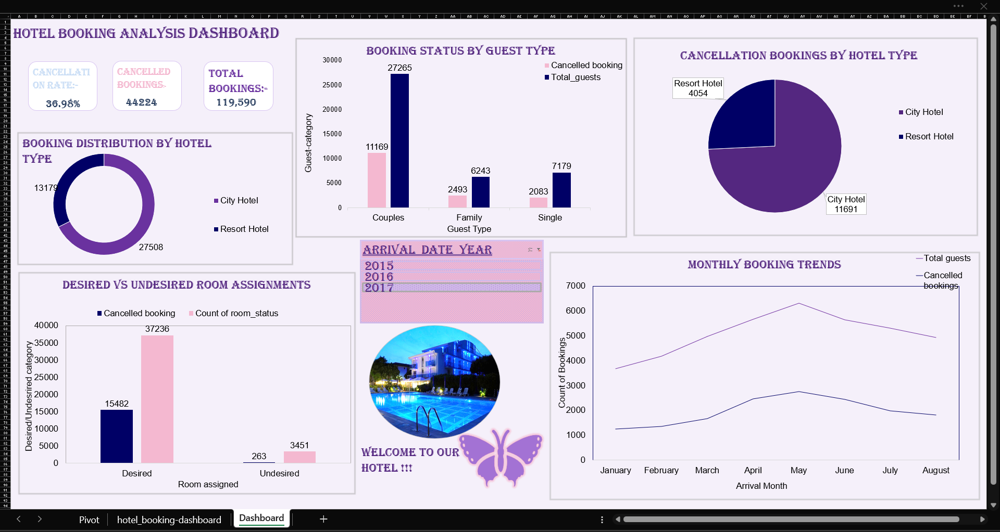

<h1 align="center">🏨 Hotel Booking Analysis Dashboard</h1><h2 align="center">📊 Microsoft Excel | Data Analytics Project</h2>

  Exploring hotel booking trends, cancellation patterns, and booking metrics through an interactive Excel dashboard.

  

---

<h1>📌 Project Overview</h1>This project focuses on analyzing hotel booking data and presenting important metrics through a dashboard created using Microsoft Excel.

The dashboard combines KPI cards, charts, and interactive filters to make booking information easier to explore and understand.

This project is part of my hands-on learning journey in Data Analytics.

---

<h1>🎯 Project Objectives</h1>- Explore hotel booking and cancellation patterns.
- Compare booking distributions across hotel types.
- Understand booking trends over time.
- Present key metrics in a visual dashboard.
- Practice interactive data exploration using Excel slicers.
- Improve data visualization and dashboard design skills.

---

<h1>🛠️ Tools and Features Used</h1>- Microsoft Excel — Data analysis and dashboard creation.
- PivotTables — Summarizing and organizing booking data.
- PivotCharts — Visualizing trends and comparisons.
- Slicers — Interactive data filtering.
- Excel Formulas — Supporting calculations and analysis.
- KPI Cards — Highlighting important metrics.

---

<h1>📈 Key Areas Explored</h1><h2>1. 🏨 Booking Overview</h2>Exploring overall booking volume and key booking metrics.

<h2>2. ❌ Cancellation Analysis</h2>Examining booking cancellations to understand cancellation patterns.

<h2>3. 🏢 Hotel Type Comparison</h2>Comparing booking distributions across hotel categories.

<h2>4. 👥 Guest and Booking Patterns</h2>Exploring booking patterns across guest categories.

<h2>5. 📅 Monthly Booking Trends</h2>Visualizing changes in booking activity over time.

<h2>6. 🛏️ Room Assignment Patterns</h2>Exploring desired and undesired room assignment patterns.

---

<h1>⚙️ Interactive Features</h1>- Excel slicers for filtering data.
- PivotTables for summarizing booking information.
- PivotCharts for visualizing selected data.
- KPI cards for displaying important metrics.

Note: Interactive features are available in the Excel workbook. The image above is a static dashboard preview.

---

<h1>📂 Project Files</h1>File| Description
"Hotel_Booking_Analysis_Dashboard.xlsx"| Excel workbook containing the dashboard
"hotel_booking_dashboard.png"| Dashboard screenshot
"README.md"| Project documentation

---

<h1>🚀 How to Explore This Project</h1>1. Open the Excel workbook from this repository.
2. Download the workbook to your computer.
3. Open it using Microsoft Excel.
4. Navigate to the dashboard sheet.
5. Use the available slicers to filter the data.
6. Explore the charts and key metrics.

---

<h1>📚 What I Learned</h1>Through this project, I practiced:

- Organizing and summarizing data using PivotTables.
- Creating charts to communicate data patterns.
- Using slicers for interactive filtering.
- Designing KPI cards and dashboard layouts.
- Selecting visualizations for analytical questions.
- Presenting information through a structured dashboard.

A tutorial helped me get started with this project. I practiced adapting the dashboard design and components while learning Excel dashboard techniques.

---

<h1>🔮 Future Improvements</h1>- Add more detailed booking and cancellation metrics.
- Improve dashboard formatting and readability.
- Explore additional trends and relationships in the data.
- Develop clearer, data-backed business insights.

---

<h1>👩‍💻 About This Project</h1>This project represents part of my journey toward becoming a Data Analyst.

I am continuing to strengthen my skills in Microsoft Excel, SQL, Python, and data visualization through hands-on projects and practical learning.

---

  <strong>Thank you for visiting my project! ❤️</strong>

  Excel • Data Analytics • Data Visualization • Dashboard Design

